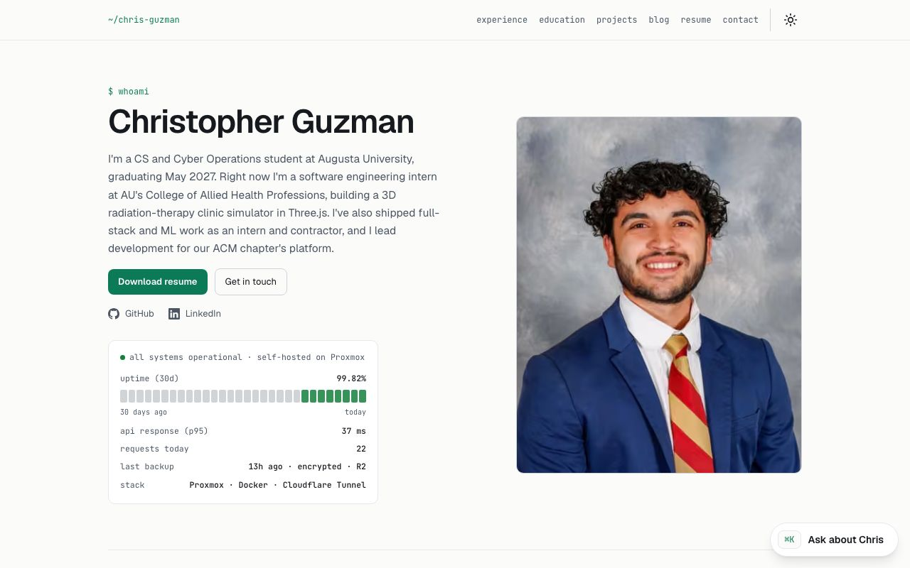
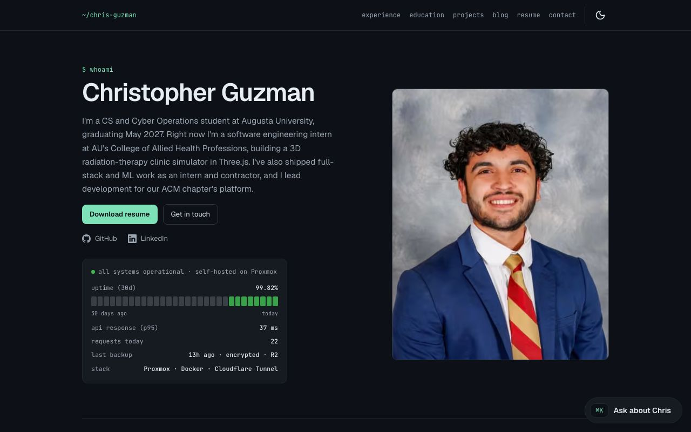
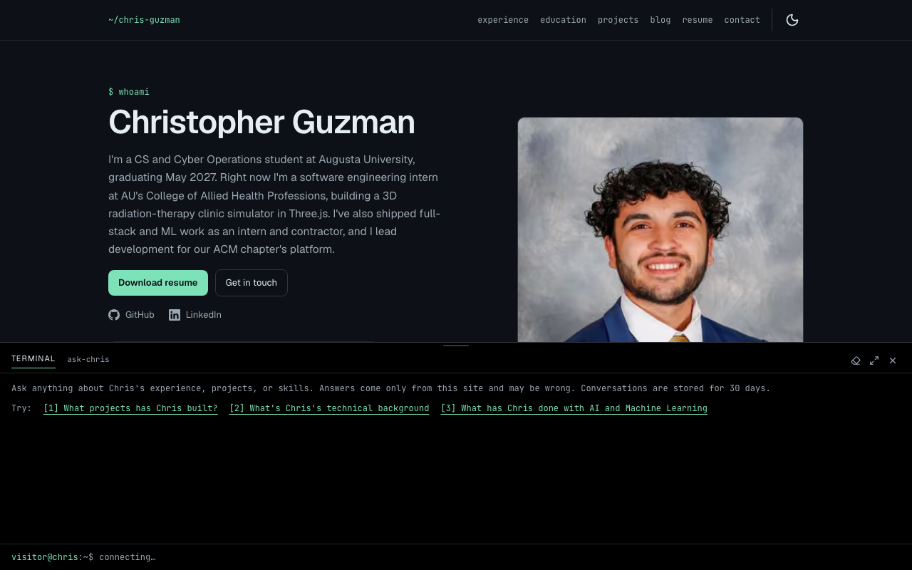
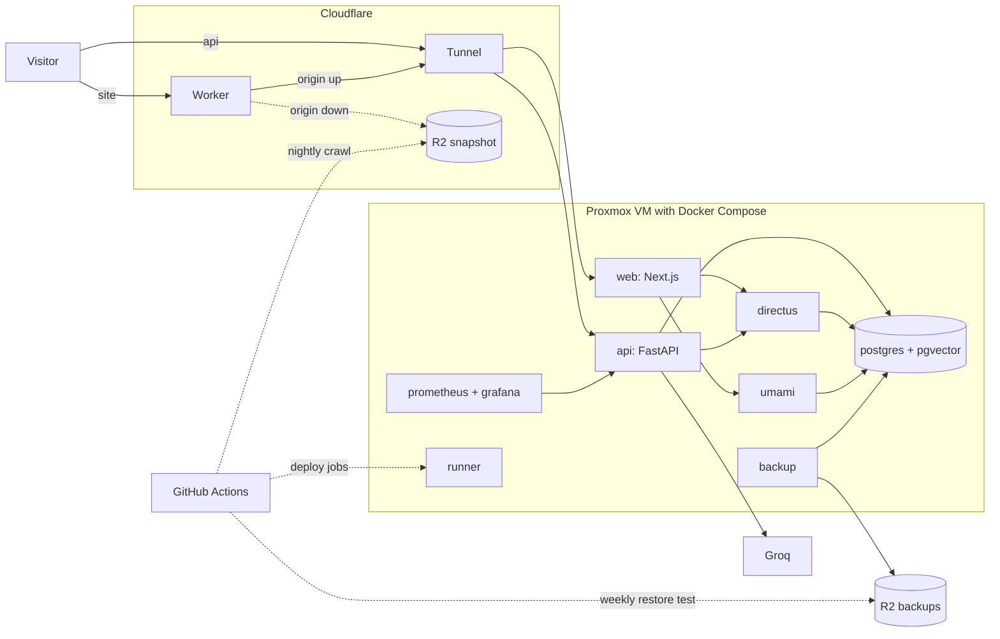

# chris-guzman-portfolio

The portfolio of Christopher Guzman, a CS and Cyber Operations student at Augusta University (graduating May 2027): experience, projects, a blog, the resume, and an AI chat that answers questions about him from the site's own content. It runs on a Proxmox VM in his home, behind a Cloudflare Tunnel.

**Live at https://christopherguzman.me.** Every merge to `main` builds, scans and deploys automatically.

[](https://github.com/chrisguzman77/chris-guzman-portfolio/actions/workflows/ci.yml)
[](https://github.com/chrisguzman77/chris-guzman-portfolio/actions/workflows/release.yml)
[](https://github.com/chrisguzman77/chris-guzman-portfolio/actions/workflows/chat-eval.yml)
[](https://christopherguzman.me)
[](LICENSE)

| Light | Dark |
|---|---|
|  |  |



## What's interesting here

- **Self-hosted at home:** the whole stack runs in Docker Compose on a Proxmox VM with no ports open to the internet, reached through a Cloudflare Tunnel and deployed by an ephemeral runner inside the VM ([ADR 0003](docs/adr/0003-cloudflare-tunnel-direct-ingress.md), [0005](docs/adr/0005-self-hosted-runner-deploys.md), [0006](docs/adr/0006-runner-in-compose.md)).
- **"Ask about Chris" chat:** answers come from the site's published content through local embeddings and Groq, and a reply that cites no source is replaced with a fixed answer before the visitor sees it ([ADR 0008](docs/adr/0008-rag-chat-on-groq.md)).
- **A chat that is measured:** weekly answer and red-team evals run against the live chat, which blocks leaks and off-site links, and the results and visitor feedback are tracked in Grafana ([ADR 0012](docs/adr/0012-chat-red-team.md), [ADR 0013](docs/adr/0013-no-reranker.md)).
- **Static failover:** when the home server is unreachable, the Cloudflare Worker serves a crawled snapshot of the site from R2 with the live features hidden ([ADR 0011](docs/adr/0011-static-failover.md)).
- **Performance budgets in CI:** a change fails CI when a page's JavaScript outgrows its budget or its median mobile Lighthouse score drops below 85 ([runbook](docs/runbook.md#performance-budget)).
- **Backups that prove themselves:** nightly backups are encrypted to a key the VM doesn't hold, stored in R2 under a 30-day bucket lock, and restored and verified every week ([ADR 0010](docs/adr/0010-backup-encryption-and-bucket-lock.md)).
- **Observability:** Prometheus and Grafana watch the VM and send alert emails, and the home page's status card shows live uptime, latency and the last backup ([ADR 0009](docs/adr/0009-monitoring-without-loki.md)).
- **Security:** a per-request nonce CSP, secrets committed only as SOPS/age ciphertext, and a written threat model ([security model](docs/security.md), [ADR 0004](docs/adr/0004-sops-age-secrets.md)).

## Architecture



Details, failure modes and the other diagrams are in [docs/architecture.md](docs/architecture.md).

## How it works

- **Repo layout:** one repository for web, api and infra, each app with its own toolchain (pnpm, uv) and Dockerfile ([ADR 0001](docs/adr/0001-monorepo.md)).
- **CMS and content:** Directus, in the same stack, is the content system of record; pages render per request from cached reads that a Directus Flow invalidates on publish ([ADR 0002](docs/adr/0002-directus-as-cms.md), [content flow](docs/architecture.md#content-flow)).
- **Ingress:** the Cloudflare Tunnel routes each hostname straight to its container, with no reverse proxy and no ports open to the internet ([ADR 0003](docs/adr/0003-cloudflare-tunnel-direct-ingress.md)).
- **Deploys:** a merge to `main` builds and Trivy-scans the images on GitHub-hosted runners, then an ephemeral runner inside the VM deploys that exact commit ([ADR 0005](docs/adr/0005-self-hosted-runner-deploys.md), [ADR 0006](docs/adr/0006-runner-in-compose.md), [runbook](docs/runbook.md#normal-deploys)).
- **Secrets:** env files are committed encrypted with SOPS and age, and decrypted on the VM at deploy time ([ADR 0004](docs/adr/0004-sops-age-secrets.md)).
- **Rate limits and jobs:** in-process sliding-window limits and asyncio background jobs in the single API container, with no Redis ([ADR 0007](docs/adr/0007-in-process-rate-limits-and-jobs.md)).
- **Chat:** hybrid search (pgvector plus full-text, merged with reciprocal rank fusion), Groq's `gpt-oss-120b`, Turnstile per session and a daily token budget ([ADR 0008](docs/adr/0008-rag-chat-on-groq.md), [architecture](docs/architecture.md#chat-phase-5)).
- **Monitoring:** Prometheus scrapes every 30 s, Grafana emails alerts, and Umami counts visits without cookies ([ADR 0009](docs/adr/0009-monitoring-without-loki.md), [runbook](docs/runbook.md#monitoring-and-analytics)).
- **Backups:** nightly, age-encrypted, uploaded to R2 and restore-tested every week ([ADR 0010](docs/adr/0010-backup-encryption-and-bucket-lock.md), [runbook](docs/runbook.md#backups)).
- **Failover:** a GitHub Actions crawl refreshes the R2 snapshot after each release and nightly, and the Worker serves it only while the origin is down ([ADR 0011](docs/adr/0011-static-failover.md), [runbook](docs/runbook.md#static-failover)).
- **Evals:** answer and refusal cases run on Sundays and red-team cases on Wednesdays, each run recorded for the Chat quality dashboard; retrieval stays RRF with no reranker ([ADR 0012](docs/adr/0012-chat-red-team.md), [ADR 0013](docs/adr/0013-no-reranker.md), [runbook](docs/runbook.md#chat-quality)).

## Layout

| Path | What |
|---|---|
| `apps/web` | Next.js (App Router, TypeScript, Tailwind, shadcn) |
| `apps/api` | FastAPI service: interactions, GitHub cache, RAG chat |
| `infra/` | Compose stacks, Postgres init, Directus schema, Cloudflare, observability |
| `docs/` | [Architecture](docs/architecture.md), [ADRs](docs/adr/README.md), [setup](docs/setup.md), [runbook](docs/runbook.md), design spec |

## Quick start

```bash
cp infra/compose/env.example infra/compose/.env
make up        # postgres + directus + api + web
make test      # web (vitest) + api (pytest)
make lint      # eslint, tsc, prettier, ruff, pyright
```

Web: http://localhost:3000 · API docs: http://localhost:8000/docs · CMS: http://localhost:8055

## Docs

- [Setup](docs/setup.md): accounts, secrets and first-time steps, phase by phase.
- [Runbook](docs/runbook.md): deploys, rollbacks, alerts, backups and recovery.
- [Security model](docs/security.md): threats, controls and the exact headers.
- [Architecture](docs/architecture.md): components, data flows and failure modes.
- [ADR index](docs/adr/README.md): the reasoning behind each infrastructure choice.
- [Design spec](docs/superpowers/specs/2026-09-16-portfolio-design.md): the system design and its seven delivery phases.
